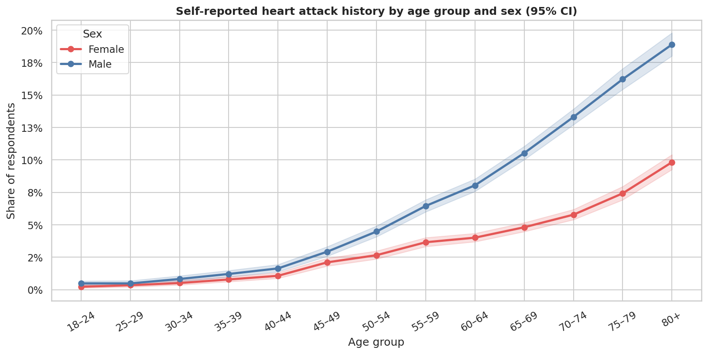
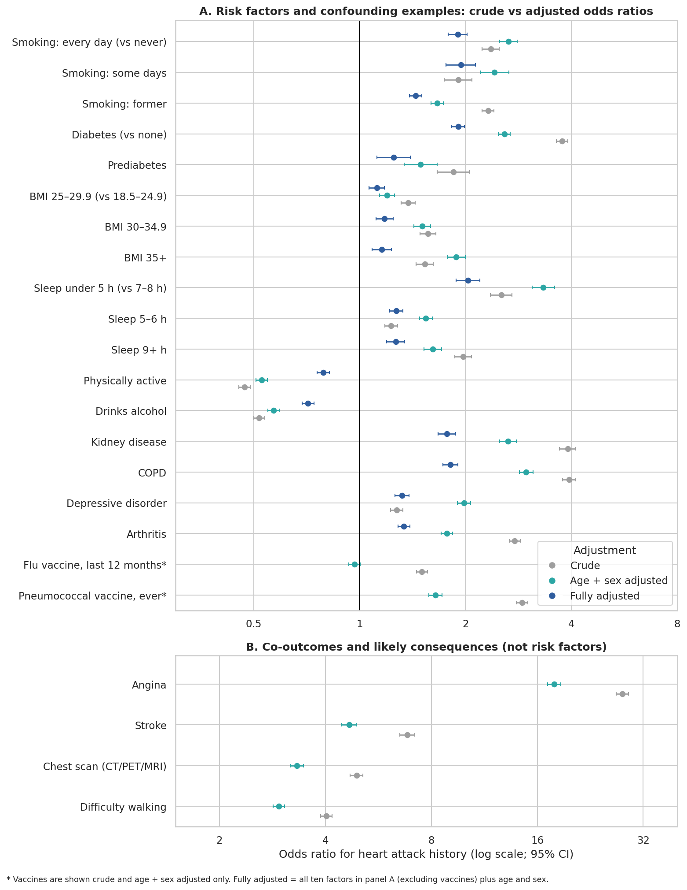
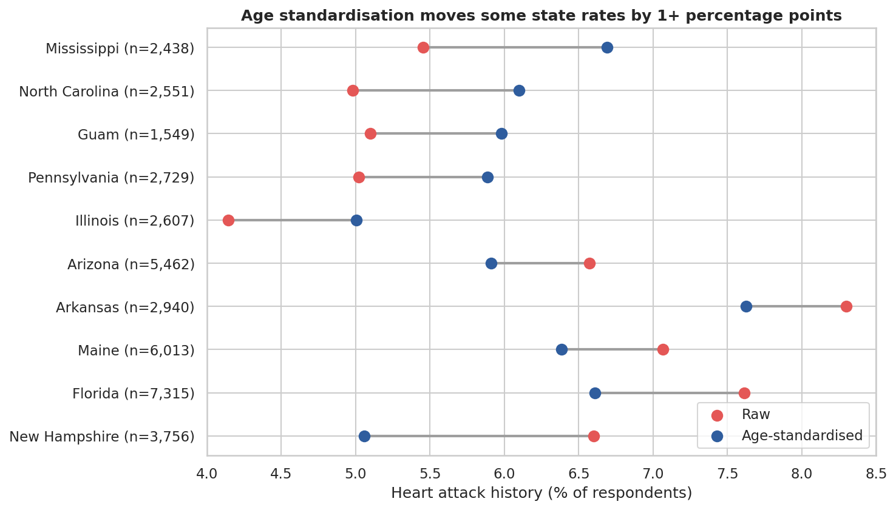
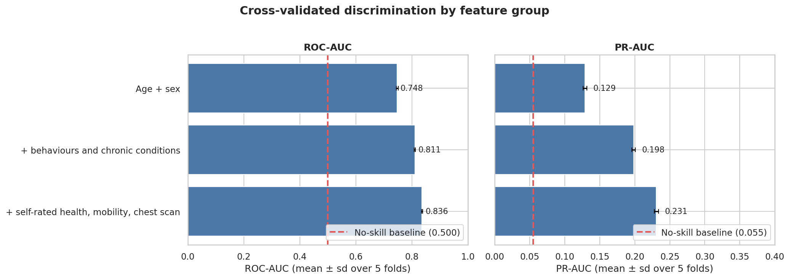

# Heart Attack History in U.S. Adults: Which Associations Survive Adjusting for Age?

An exploratory analysis of **246,022 adult survey respondents** (what appears to be an extract of the CDC's 2022 Behavioral Risk Factor Surveillance System) that asks which familiar risk factors stay associated with a self-reported history of heart attack once age and sex are held constant, and which turn out to be artifacts of age or likely consequences of heart disease.

**Python · pandas · seaborn · statsmodels · scikit-learn** | Notebook: [`heart_attack_risk_factors_eda.ipynb`](heart_attack_risk_factors_eda.ipynb)

This is a cross-sectional, self-reported, unweighted survey sample restricted to complete cases. It supports descriptive analysis, not clinical advice, national estimates or causal claims.

## Key findings

1. **Age dominates.** Heart attack history rises from 0.4% among 18–24 year-olds to 13.6% among those 80 and older, a 36-fold gradient. Men report it more often than women (7.2% vs 3.9%), and the gap persists at every age (age-adjusted odds ratio 2.14, 95% CI 2.07–2.22).
2. **Several crude associations are age artifacts.** Flu vaccination looks harmful on its own (odds ratio 1.50) but is null after adjusting for age and sex (0.97). Diabetes falls from 3.76 to 2.58 to 1.91 as adjustment increases.
3. **After full adjustment, the clearest associations** are with smoking, diabetes, COPD, kidney disease and very short sleep. Sleep is U-shaped, and obesity is a modest association once other factors are included.
4. **Some "predictors" are really consequences.** Half of heart-attack respondents also report angina, so angina, chest scans, walking difficulty and self-rated health are kept out of the risk-factor model.
5. **Age and sex alone give a cross-validated ROC-AUC of 0.75**, rising to 0.81 with behaviours and chronic conditions and 0.84 with self-rated health and mobility.
6. **State comparisons need age standardisation**, which moves some states by more than a percentage point.

## Finding 1: age and sex come first

| Age group    | Respondents | Heart attack history |
| ------------ | ----------: | -------------------: |
| 18–24        |      13,122 |                0.38% |
| 40–44        |      16,973 |                1.34% |
| 50–54        |      19,913 |                3.53% |
| 60–64        |      26,720 |                5.89% |
| 70–74        |      25,739 |                9.36% |
| 80 and older |      17,816 |               13.62% |

Men are higher than women in every age group, by about 1.4 to 2.3 times. Because the age mix differs between nearly every pair of groups, crude comparisons are unreliable without adjustment.

## Finding 2: crude vs adjusted associations

Each factor is compared with its reference group three ways: crude, adjusted for age group and sex, and fully adjusted (ten factors plus age and sex in one logistic regression). Odds ratios with 95% confidence intervals:

| Factor (vs reference)         |            Crude | Age + sex adjusted |   Fully adjusted |
| ----------------------------- | ---------------: | -----------------: | ---------------: |
| Smoking: every day (vs never) | 2.36 (2.23–2.49) |   2.65 (2.50–2.81) | 1.90 (1.79–2.02) |
| Smoking: former               | 2.32 (2.23–2.41) |   1.66 (1.60–1.73) | 1.44 (1.39–1.50) |
| Diabetes (vs none)            | 3.76 (3.62–3.91) |   2.58 (2.48–2.68) | 1.91 (1.83–1.99) |
| Sleep under 5 h (vs 7–8 h)    | 2.53 (2.36–2.71) |   3.33 (3.10–3.58) | 2.03 (1.88–2.20) |
| BMI 30–34.9 (vs 18.5–24.9)    | 1.57 (1.49–1.65) |   1.51 (1.43–1.59) | 1.18 (1.11–1.25) |
| Physically active             | 0.47 (0.45–0.49) |   0.53 (0.51–0.55) | 0.79 (0.76–0.82) |
| Kidney disease                | 3.90 (3.70–4.12) |   2.64 (2.50–2.79) | 1.77 (1.67–1.88) |
| Depressive disorder           | 1.27 (1.22–1.33) |   1.98 (1.90–2.07) | 1.32 (1.26–1.38) |
| Flu vaccine, last 12 months   | 1.50 (1.45–1.56) |   0.97 (0.93–1.00) |     not modelled |

Why they move: older people are vaccinated more and have more diabetes and kidney disease, so those crude ratios are inflated by age. Respondents with depression are younger (43.5% under 50, against 33.2% of others), so its association gets stronger once age is held constant. Former smokers are older (25.1% under 50, against 39.1% of never-smokers), which inflates their crude ratio.

### Cautions on interpretation

- Alcohol drinkers have lower odds (0.71 fully adjusted). That is not evidence that drinking protects the heart: people often stop drinking or smoking after a diagnosis, so "non-drinker" and "former smoker" mix cause and consequence. The same problem applies to physical activity.
- Angina (crude odds ratio 27.9), stroke (6.8), chest scans (4.9) and walking difficulty (4.0) reflect shared or existing disease, not prediction. 50.4% of heart-attack respondents report angina against 3.5% of others, and 18.7% report a stroke against 3.3%.

## Finding 3: state rates before and after age standardisation

States differ in age structure, so raw rates partly reflect who lives there. Direct age standardisation (using the pooled age mix of all respondents) moves Florida from 7.61% to 6.61% and New Hampshire from 6.60% to 5.06%, while Mississippi rises from 5.46% to 6.69% and North Carolina from 4.98% to 6.10%. The ranking is fairly stable overall (Spearman 0.80). These samples are unweighted complete cases ranging from 743 to 15,000 respondents, so the comparison illustrates the method and is not a state health ranking.

## Finding 4: how much does each group of fields add?

Five-fold cross-validated logistic regressions on nested feature sets. This shows how much of the outcome each group can explain; it is not a screening tool.

| Features                                  | ROC-AUC | PR-AUC |
| ----------------------------------------- | ------: | -----: |
| No-skill baseline                         |   0.500 |  0.055 |
| Age + sex                                 |   0.748 |  0.129 |
| + behaviours and chronic conditions       |   0.811 |  0.198 |
| + self-rated health, mobility, chest scan |   0.836 |  0.231 |

The last step is partly consequences of illness already present, so its apparent gain overstates real risk information.

## Data and limits

- 246,022 rows, 40 columns, no missing values by construction (respondents with any missing answer were removed), and 9 coincidental duplicate rows that are kept. The outcome is positive for 13,435 respondents (5.46%).
- **No survey weights or design variables**, so percentages describe these respondents, not U.S. adults. Complete-case filtering can also bias the sample.
- Single cross-section and self-reported: the order of exposure and outcome is unknown, so nothing here is causal.
- Race and ethnicity, income, education and access to care are not analysed; omitted variables affect every adjusted estimate. Race and ethnicity are deliberately left out because group comparisons without socioeconomic and survey-design context are easy to misread.
- Odds ratios are not risk ratios and overstate relative risk somewhat for a 5.5% outcome.
- Extreme values (BMI above 50 for 2,171 respondents, sleep of 2 hours or less for 1,303) are handled by grouping BMI and sleep into bands.

## Possible next step

Use the full survey file with its weights and design variables to produce population estimates, add socioeconomic factors, model age as a continuous variable, and, if longitudinal data become available, study which exposures precede a first event.

## Data source and attribution

The analysed file is `heart_2022_no_nans.csv`, which appears to be a processed extract of the CDC's 2022 Behavioral Risk Factor Surveillance System (BRFSS), judging by its variables and state coverage.
